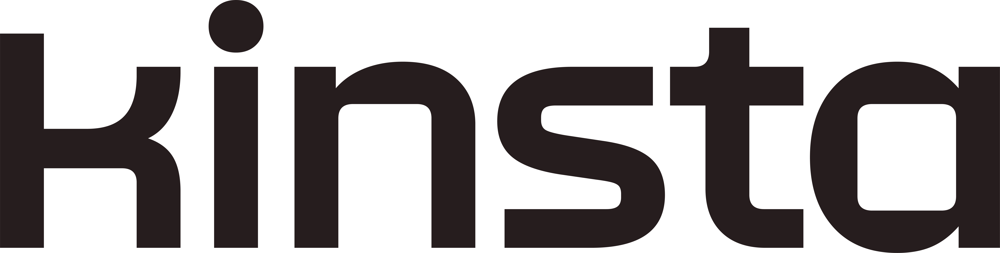
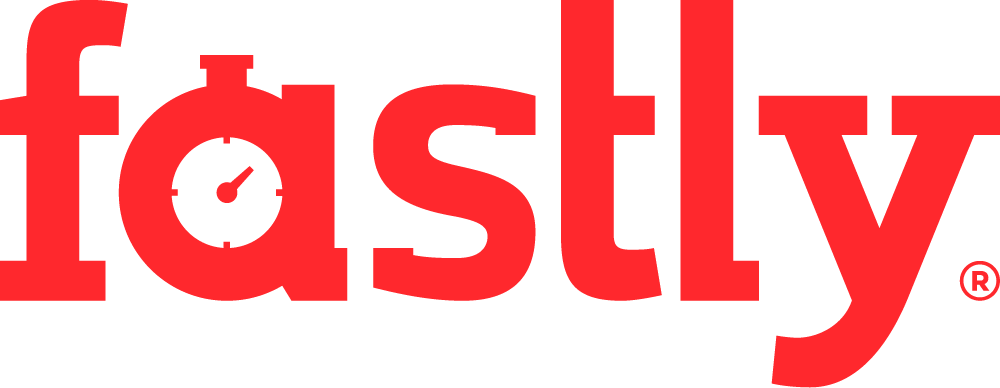
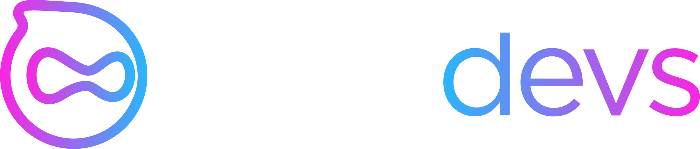

## About

This is a home for packaging various software into Debian and Ubuntu.  Most notable package under DEB.SURY.ORG is the PHP packaging.

## PHP LTS by Freexian

Commercial long-term support for PHP.  PHP LTS is a service prepared together
with [Freexian](https://www.freexian.com): Debian packages for multiple PHP
releases on multiple Debian and Ubuntu releases, with dependable security
support over an extended period of time.  If you use the PHP packages to run
business, this is the way to get support and to support this project.

[PHP LTS by Freexian](https://www.freexian.com/lts/php/)
{.cta}

## Who am I?

I am a Debian Developer since year 2000, and I have been packaging PHP for
Debian since PHP 5.  That means the official packages in Debian and Ubuntu are
either my work or they are based on my work.  The PHP packages in my Debian DPA
matches the official packages in Debian.  Basically I am saying that you can't
get any closer than that.

## Acknowledgements

This service would not exist without the support from companies that trust us and support the project directly or via [PHP LTS by Freexian](https://www.freexian.com/lts/php/). Many thanks to them!

* 
* 
* 
* 
* 
* 
{.logos}

## Packages

All packaging work is either done directly in the Debian unstable, or it will be
in the unstable sooner or later.

### PHP Packages

The main repository now contains PHP 5.6, PHP 7.0-7.4 and PHP 8.0-8.6
coinstallable together.

#### Debian DPA

* [packages.sury.org/php](https://packages.sury.org/php/) -- the main PHP repository for Debian and Ubuntu

#### Freexian Repository for Debian Stretch, Buster, Bullseye, Bookworm and Trixie and Ubuntu Bionic, Focal, Jammy, Noble and Resolute {#freexian-repository}

* [PHP LTS by Freexian](https://www.freexian.com/lts/php/) -- PHP LTS repository prepared together with [Freexian](https://www.freexian.com) with commercial support

## News

I publish the most important changes in the packaging and interesting news in
dedicated Mastodon feed at [deb@sury.org](https://mastodon.rfc1925.org/@deb).

## Bug Reporting

DEB.SURY.ORG has now public lightweight [issue tracker](https://codeberg.org/oerdnj/deb.sury.org/issues)
at [CodeBerg](https://codeberg.org). Please report any bugs or feature requests for the repositories
there, since my INBOX is a not very reliable way how to keep track on all issue
since it has the tendency to grow number of unread messages to numbers over
thousand...

Also please excuse me if I don't respond to your email, my INBOX is really a
mess and if you are not lucky, you might get stuck with other unread emails. So
pretty please use new [issue tracker](https://codeberg.org/oerdnj/deb.sury.org/issues).

## Documentation

The available documentation related to the packages and PPAs is hosted in the
[Wiki](https://codeberg.org/oerdnj/deb.sury.org/wiki).  Everybody can contribute,
so if you want to write more documentations on the PHP packages, you are
certainly welcome to do so.

## Support

The PHP packaging is time consuming and I do this mostly in my free time.
Please consider buying commercial support from Freexian if you use PHP packages
to run business or donating if you find the PHP packages useful for
your projects. 

It also warms a heart to know that this project is useful.

* Commercial support:
  * [PHP LTS by Freexian](https://www.freexian.com/lts/php/)
* Ways how to donate:
  * Donate on [OpenCollective](https://opencollective.com/debsuryorg)
  * Donate on [GitHub](https://github.com/sponsors/oerdnj)
  * Contact me via [email](mailto:ondrej@sury.org?Donate%20to%20DEB.SURY.ORG) if you need something more special (invoice, I am an EU VAT payer)

## Sponsors

This section is dedicated to individuals and companies who contribute more than $100 a month or made a significant contribution in a given calendar year.

* [Laravel](https://laravel.com) - The PHP Framework for Web Artisans
* [Stepan Kocourek](https://kocourek.uk)
* [root360](https://www.root360.de)
* [Onlime](https://www.onlime.ch/en/)
* [iO](https://www.iodigital.com/en)
* [qwertiko](https://www.qwertiko.de)
* [SysEleven](https://www.syseleven.de) - Managed Kubernetes – Made in Germany
* [CanTrust](https://cantrusthosting.coop/) - Trusted Canadian web hosting
* [BlackHost](https://black.host) - Unmetered web hosting company
* [Mythic Beasts](https://www.mythic-beasts.com) - No-nonsense hosting with excellent technical support
* [Bunny.net](https://bunny.net) - The global content delivery platform that truly hops
